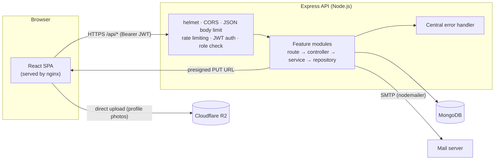
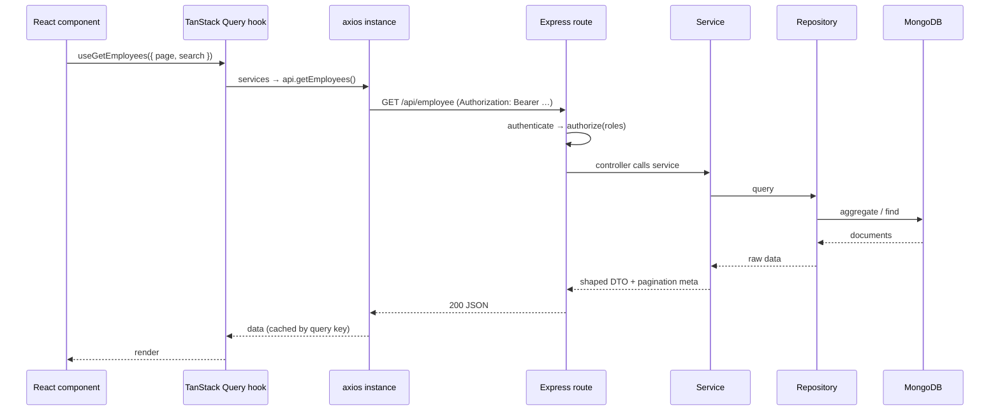
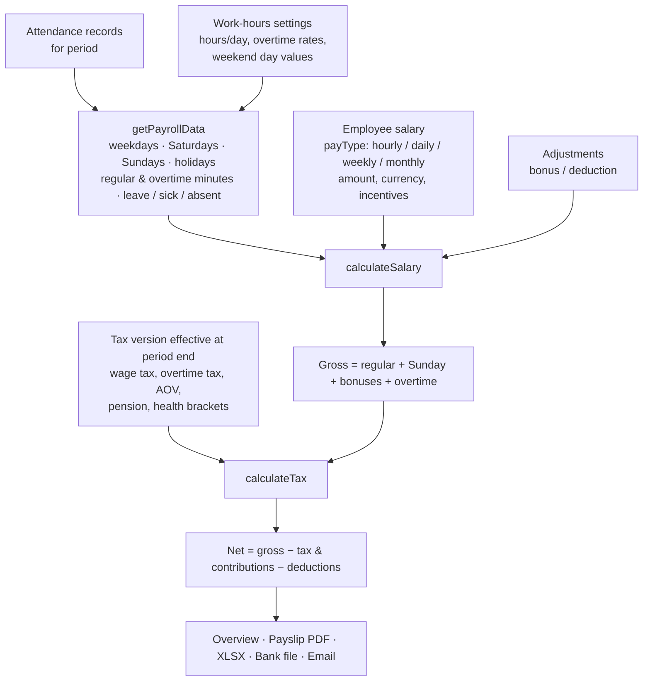
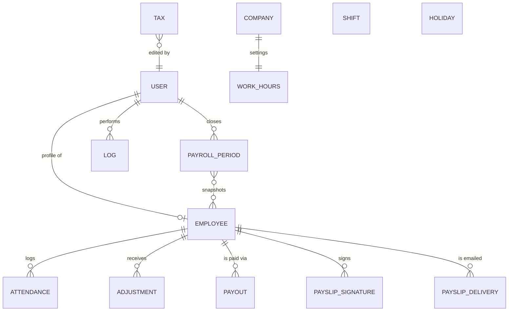
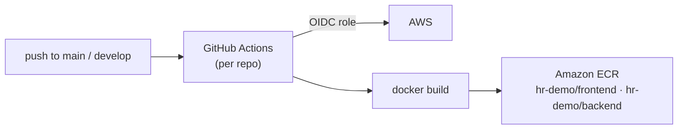

# HR Payroll (Demo)

> [!WARNING]
> **This project is for demonstration only.** It is not production-ready software and must not be used to run a real payroll or HR process without guidance from the author and review by a qualified payroll or tax professional.
>
> - The sample data is made up. This includes the company name, address and contacts in [`shared/constants`](server/shared/constants/index.js).
> - Pay and tax calculations have not been audited. Payslips, tax deductions and bank files produced by this app are not legal or financial documents.
> - Tax rules change. The tables included are examples and may be out of date.
> - No warranty is given. You use it at your own risk.

> [!IMPORTANT]
> **Built for the Suriname market.** The HR and tax rules follow Surinamese practice and will not be correct for other countries without significant changes:
>
> - **Taxes:** Surinamese wage tax (*loonbelasting*) brackets with a tax-free allowance, a separate overtime tax, a special-payments rate, and exemptions for holiday allowance, bonus and child allowance. The default tax table references *S.B. 2024 no. 2*, effective 1 July 2025.
> - **Contributions:** AOV (state old-age pension), plus pension and health insurance with employee and employer shares.
> - **Currencies:** SRD (Surinamese dollar) is the main currency, with USD and EUR exchange rates kept in the app.
> - **Time zone:** the company clock is fixed at UTC−3 (Suriname time).
> - **Pay practices:** hourly, daily, weekly and monthly pay types, weighted Saturday/Sunday days and overtime rates, as is common in local employment.

A demo web app showing how a small Surinamese company could run HR and payroll: employees, timesheets, holidays, leave, payroll runs, payslips (PDF, e-signature, email), payouts, tax settings and an audit log.

The repository has two parts, each its own git repository (tracked here as submodules):

| Folder | What it is | Stack |
| --- | --- | --- |
| [`client/`](client/) | Single-page web app | React 19, Vite, TypeScript, TanStack Query, Redux Toolkit, Tailwind + HeroUI / MUI |
| [`server/`](server/) | REST API | Node.js, Express 5, Mongoose (MongoDB) |

---

## System design

### High-level architecture



- The **client** is a static bundle. All data comes from the API over JSON.
- The **server** is stateless. It reads the user from MongoDB on every request, so a deactivated or deleted user is locked out immediately, even with a valid token.
- **MongoDB** is the only persistent store.
- **Cloudflare R2** (S3-compatible) holds employee profile images. The API only signs a 60-second upload URL; the browser uploads the file directly.
- **SMTP** sends payslips by email. Setting `MAIL_TRANSPORT=json` makes nodemailer write messages out instead of sending them, which is useful in development.
- **Redis** has a client in [`server/config/redis.js`](server/config/redis.js), but no module uses it right now.

### Request lifecycle



If anything throws, it is passed to `next(error)` and handled by [`error.middleware.js`](server/shared/middleware/error.middleware.js). That middleware turns `ApiError`s, Mongoose validation and cast errors, and body-parser errors into `{ success: false, message }` with the right status code. Only 5xx errors are logged.

---

## Server

### Layout

```
server/
├── server.js              # entry: load env, register models, connect Mongo, listen, /health
├── app.js                 # Express app: security middleware, CORS, route mounting, error handler
├── config/                # env, MongoDB (cached connection), Redis, R2 client
├── database/
│   ├── index.js           # auto-registers every schema in models/ as a Mongoose model
│   ├── models/            # Mongoose schemas
│   ├── plugins/           # activityLog.plugin.js (audit trail)
│   ├── migrations/        # one-off data scripts
│   └── seeders/           # admin.seed.js
├── modules/<feature>/     # one folder per domain (see below)
└── shared/
    ├── constants/         # roles, pay types, company defaults
    ├── middleware/        # auth, authorize, rateLimit, error
    ├── services/          # mail.service.js
    └── utils/             # ApiError, password hashing, date/payroll helpers, requestContext
```

`module-alias` maps `@/` to the server root, so modules can `require("@/shared/...")`.

### Module pattern

Each feature in `modules/` uses the same layers:

| File | Responsibility |
| --- | --- |
| `*.routes.js` | Express router: URL → middleware chain → controller |
| `*.controller.js` | Reads `req`, calls the service, writes the HTTP response, forwards errors with `next(error)` |
| `*.service.js` | Business rules, validation, response shaping. Throws `ApiError(status, message)` |
| `*.repository.js` | All database access (Mongoose queries and aggregation pipelines) |
| `*.model.js` | Binds a schema from `database/models/` to a Mongoose model |
| `*.utils.js` | Pure helpers for that domain |

### API surface

All routes are mounted under `/api` in [`app.js`](server/app.js).

| Prefix | Module | Purpose |
| --- | --- | --- |
| `/auth` | auth | Login (rate-limited), `me`, change password |
| `/dashboard` | dashboard | Monthly KPIs, payroll breakdown, adjustments feed |
| `/employee` | employee | Employee CRUD (paginated list) |
| `/attendance` | attendance | Timesheet entries per employee/day |
| `/leave` | leave | Leave balances |
| `/holiday` | holiday | Public holidays |
| `/adjustment` | adjustment | One-off bonuses and deductions |
| `/payroll` | payroll | Overview, payslip PDF, signed PDF, XLSX export, bank file, email one/all |
| `/payroll/payouts` | payout | Record payout lines against an employee's net pay |
| `/payroll-periods` | period | Close (freeze) or reopen a payroll period |
| `/settings` | settings | Settings summary |
| `/settings/company` | company | Company profile, logo, defaults |
| `/settings/currencies` | currency | SRD / USD / EUR exchange rates |
| `/settings/shifts` | shift | Shift definitions |
| `/settings/tax` | tax | Versioned tax tables, payroll tax toggle, tax preview |
| `/settings/work-hours` | workhours | Work-week hours, overtime rates, period-locking switch |
| `/users` | user | Staff accounts (admin only) |
| `/logs` | log | Audit log (admin only) |
| `/uploads/presigned-url` | r2 | Presigned R2 upload URL |

`GET /health` (outside `/api`) returns `{ status: "ok" }` for load balancers.

### Authentication and authorization

1. `POST /api/auth/login` checks the email and password (bcrypt) and returns a JWT (`{ id }`, lifetime `JWT_EXPIRES_IN`, default `7d`). Failed attempts are rate-limited per IP and email (`LOGIN_MAX_ATTEMPTS` per 15 minutes). When the email does not exist, the server waits as long as a real password check would, so response times don't reveal which emails exist.
2. [`auth.middleware.js`](server/shared/middleware/auth.middleware.js) verifies the token, loads the user, and rejects the request if the user is deleted, inactive, or has a role that isn't a staff role. It sets `req.user` and starts a **request context** (see below).
3. [`authorize.middleware.js`](server/shared/middleware/authorize.middleware.js) limits write routes to specific roles.

| Role | Read | Edit HR / payroll data | Admin areas (users, logs, tax, reopen periods) |
| --- | :-: | :-: | :-: |
| `admin` | ✓ | ✓ | ✓ |
| `payroll` | ✓ | ✓ | |
| `manager` | ✓ | ✓ | |
| `viewer` | ✓ | | |

Seeded admins start with `mustChangePassword: true`, and the client blocks the app until the password is changed.

### Audit log

Every change to an important record is logged automatically, without code in each service:

- [`requestContext.js`](server/shared/utils/requestContext.js) uses Node's `AsyncLocalStorage` to remember who is making the request (`userId`, `userName`) for the rest of that request.
- [`activityLog.plugin.js`](server/database/plugins/activityLog.plugin.js) is a Mongoose plugin. It hooks `save`, `findOneAndUpdate` and `findOneAndDelete`, takes a *before* snapshot, and after the write calls `log.service.record()`.
- `log.service` flattens both versions, compares them field by field (skipping noise fields such as `password`, timestamps and `__v`), shortens long values, and stores a `Log` document with the entity, the action (`CREATE` / `UPDATE` / `DELETE`), a readable description and the user from the request context.

The plugin is used by these models: `user`, `attendance`, `holiday`, `shift`, `tax`, `payrollPeriod`, `payout` and `payslipDelivery`. If writing a log entry fails, the error is logged and the original write still succeeds.

### Payroll engine

Pay is not stored. Every time payroll is viewed, exported or emailed, it is calculated from attendance and settings:



Main rules (in [`payroll.utils.js`](server/modules/payroll/payroll.utils.js)):

- **Hourly and daily** pay is regular time × rate. If the employee has full attendance and a `incentive_weekdays` rate, that rate is used instead.
- **Weekly and monthly** pay is fixed. Pay for absent scheduled days is deducted.
- **Overtime** is weighted by the configured overtime rates. It can be paid on the base rate (`overtimeOnBaseRate`) or on the effective rate.
- **Tax** is optional (a payroll setting). Tax tables have versions with an `effectiveFrom` date, and the version in force at the end of the period is applied. The defaults in [`tax.utils.js`](server/modules/tax/tax.utils.js) model the Surinamese system: wage tax, overtime tax, special payments, AOV, pension and health insurance. They are demo values. Check them against current Surinamese law before relying on any result.

### Payroll period locking

When `lockPeriods` is turned on in work-hours settings, closing a period ([`period.service.js`](server/modules/period/period.service.js)):

1. Rejects the period if it overlaps a period that is already closed.
2. Takes a **snapshot** of the work-hours settings, the tax toggle, the tax version in force, and every employee's salary and incentive fields.
3. Locks the period: `assertOpen()` makes edits to attendance and adjustments on dates inside a closed period fail with `409`.

When payroll is calculated for a closed period, `getFrozenContext()` returns the snapshot. Pay is calculated with the old settings and salaries, so later raises or tax changes don't change payslips that were already issued. Only admins can reopen a period.

### Payslips and delivery

- **PDF**: payslips are generated on the server with `pdfkit`, using the company logo and details.
- **E-signature**: the client captures a signature on a canvas and sends it as a PNG data URL. The server checks the PNG magic bytes and size, saves it as a `PayslipSignature` for that employee and period, and returns the signed PDF.
- **Email**: one payslip or all of them, sent through `mail.service`. Each send is recorded in `PayslipDelivery`, which is audited.
- **Exports**: an XLSX payroll register (`exceljs`, with totals) and a bank payment file.
- **Payouts**: payout lines are recorded against each employee's calculated net pay, so the overview shows paid, partial or unpaid.

### Data model



| Collection | Notes |
| --- | --- |
| `users` | Login identity and role. Employees are users too (name, email, phone, photo). Soft-deleted |
| `employees` | Links to a user. Employment type, salary `{ payType, amount, currency }`, incentives, hire and end dates |
| `attendances` | One row per employee per day: begin/end times, worked/break minutes, type (work, leave, sick, absent…) |
| `adjustments` | Dated bonus or deduction |
| `holidays`, `shifts` | Calendar and shift templates |
| `companies` | Company profile, exchange rates, payroll options |
| `taxes` | Versioned tax tables |
| `payrollperiods` | Closed periods with their settings and employee snapshots |
| `payouts`, `payslipsignatures`, `payslipdeliveries` | Records of payment, signing and delivery |
| `logs` | Audit trail |

### Time handling

Dates are stored as UTC midnight (`YYYY-MM-DD`) and handled with `dayjs.utc`. Times of day (`begin`, `end`) are stored as `HH:mm` strings and turned into minutes for calculations. The company's local offset is a constant (`CONSTANT_UTC_OFFSET_MINUTES = -180`, UTC−3).

---

## Client

### Layout

```
client/src/
├── index.tsx              # providers: Redux → React Query → Suspense(App + global modal) → toaster
├── App.jsx                # RouterProvider
├── app/
│   ├── config/            # hash router + route guards (Guest, Protected, Admin, Staff)
│   ├── layouts/           # main shell + sidebar
│   ├── providers/         # Redux (with persist), QueryClient, toaster
│   ├── store/             # auth slice (persisted) + modal slice
│   └── i18n/              # i18next: en, es, cn
├── features/<feature>/    # vertical slices (see below)
└── shared/
    ├── api/axios.ts       # axios instance: base URL, Bearer token, 401 → logout
    ├── components/        # modal host + registry, data table, UI primitives
    └── utils/
```

### Feature slices

Every feature folder (`employees`, `attendance`, `payroll`, `dashboard`, `settings`, `holidays`, `leave`, `logs`, `users`, `auth`, `account`) uses the same structure:

```
features/employees/
├── api/          # raw axios calls, one function per endpoint
├── services/     # thin wrappers the hooks call
├── hooks/        # TanStack Query useQuery / useMutation hooks
├── pages/        # routed screens (lazy-loaded)
├── forms/        # modal forms (react-hook-form + zod)
├── components/
├── *.schema.ts   # zod validation
├── *.types.ts
└── routes.tsx    # RouteObject[] merged into the app router
```

Data flows **page → hook → service → api → axios**. Server data is cached by TanStack Query, keyed by resource and parameters (for example `["employees", page, search]`). Mutations invalidate the matching keys.

### State

| Kind | Where |
| --- | --- |
| Server data | TanStack Query cache |
| Session (token, role, profile, `mustChangePassword`) | Redux `auth` slice, saved to `localStorage` with `redux-persist` |
| Global modal | Redux `modal` slice + [`modal/registry.ts`](client/src/shared/components/modal/registry.ts): components dispatch `openModal({ type, props })`, and one `<ModalGlobal />` lazy-loads the registered component |
| Form state | `react-hook-form` |

### Routing and access control

The app uses a **hash router**, so it can be served as plain static files without server-side rewrites. The guards are nested:

```
GuestRoute            → /login (redirects away if already signed in)
ProtectedRoute        → needs a token, syncs the profile, forces a password change if required
  └─ StaffRoute
      └─ Main layout  → dashboard, employees, attendance, leave, payroll
          └─ AdminRoute → holidays, settings, users, logs
```

`usePermissions()` exposes `isAdmin` and `canEdit` so the UI can hide actions. The server still enforces every rule; the client checks only control what is shown.

The axios response interceptor handles session expiry in one place. Any `401` (except from login) clears the stored session and sends the user to `#/login`.

---

## Build and deployment



- **Client image**: multi-stage build. `node:22-alpine` runs `vite build`, then the `dist/` folder is served by `nginx:alpine` on port 80. `VITE_*` variables are compiled in at build time.
- **Server image**: `node` running `node server.js`. Set `PORT` explicitly in production: the Dockerfile exposes 5000, `.env.example` uses 9000, and the code falls back to 3000 or 9000.
- Images are tagged with the short commit SHA. AWS access uses GitHub OIDC (`AWS_ROLE_ARN`), so no long-lived keys are stored.
- `pm2.json` is also available for running the API on a plain VM.
- Both server and client send `X-Robots-Tag: noindex` and a disallow-all `robots.txt`, because this is an internal tool.

---

## Running locally

> [!NOTE]
> These steps are for trying the demo on your own machine. Don't deploy it for real employees or real payroll data without guidance (see the warning at the top).

Requirements: Node 20 or newer and a MongoDB instance.

```bash
# 1. API
cd server
cp .env.example .env.development   # server.js loads .env.<ENV>, default "development"
cp .env.example .env               # config/env.js and the seeder read .env
npm install
npm run seed                       # needs SEED_ADMIN_EMAIL / SEED_ADMIN_PASSWORD
npm run dev                        # http://localhost:9000

# 2. Web app
cd ../client
cp .env.example .env               # VITE_PUBLIC_BACKEND_URL=http://localhost:9000/api
npm install
npm run dev                        # http://localhost:3000
```

Sign in with the seeded admin. You'll be asked to set a new password first.

### Server environment variables

| Variable | Purpose |
| --- | --- |
| `PORT`, `NODE_ENV`, `ENV` | Port and environment (`ENV` chooses which `.env.<ENV>` file is loaded) |
| `MONGO_URI` | MongoDB connection string |
| `JWT_SECRET`, `JWT_EXPIRES_IN` | Token signing key and lifetime |
| `CORS_ORIGINS` | Comma-separated list of allowed origins |
| `TRUST_PROXY` | Set when running behind a load balancer, so rate limiting sees real client IPs |
| `LOGIN_MAX_ATTEMPTS` | Failed logins allowed per 15 minutes (default 10) |
| `R2_ACCOUNT_ID`, `R2_ACCESS_KEY_ID`, `R2_SECRET_ACCESS_KEY`, `R2_BUCKET_NAME`, `ASSET_BASE_URL` | Profile image storage and the public URL to read images from |
| `MAIL_TRANSPORT`, `MAIL_FROM`, `SMTP_*` | Payslip email (`MAIL_TRANSPORT=json` writes messages out instead of sending them) |
| `REDIS_*` | Reserved (client configured, not used yet) |
| `SEED_ADMIN_EMAIL`, `SEED_ADMIN_PASSWORD` | First admin account |
